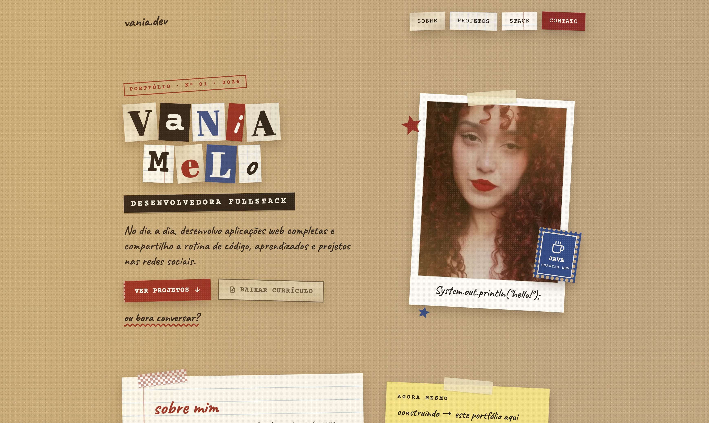

# vania.dev · portfólio

Meu portfólio pessoal de desenvolvedora fullstack, com cara de diário de scrapbook: papel kraft, fita adesiva, polaroids que "revelam" a foto, carimbos e anotações à mão.

🔗 **[Ver o site no ar](https://vania-melo.vercel.app)**



## Sobre o projeto

A ideia era fugir do portfólio genérico de fundo escuro e mostrar personalidade sem perder o lado profissional. Todo o visual é inspirado no meu jogo favorito chamado Life Is Strange, em diários de fotografia e cadernos de colagem: cada seção é um pedaço de papel diferente, colado na página.

Por trás da estética, o foco foi um site **leve, acessível e fácil de manter**.

## Tecnologias

- **React 19** com **Vite**
- **CSS puro**, sem bibliotecas de UI
- **oxlint** para análise estática do código

## Decisões técnicas

### Texturas sem nenhuma imagem
O papel kraft, as folhas pautadas e quadriculadas, as bordas rasgadas e a fita adesiva são feitos só com CSS: `radial-gradient` e `repeating-linear-gradient` para as texturas e `clip-path: polygon()` para o rasgado. Nenhum byte de imagem é baixado para o fundo da página.

### Efeitos de tinta e fotografia
- **Polaroid que revela:** os prints dos projetos começam desbotados (`filter: sepia() contrast() saturate()`) e ganham cor no hover ou no foco do teclado.
- **Carimbo:** borda dupla, rotação e `mix-blend-mode: multiply` para a tinta se misturar com a textura do papel, mais uma `mask-image` que simula tinta falhada.
- **Sombra que acompanha o recorte:** como o `clip-path` corta a `box-shadow`, os cartões rasgados usam `filter: drop-shadow()` no elemento externo.

### Performance
- Imagens em **WebP**, com `width` e `height` definidos para o layout não "pular" enquanto carregam.
- Prints dos projetos com `loading="lazy"`: só são baixados quando aparecem na tela.
- Foto do topo com `fetchPriority="high"`, porque é uma das primeiras coisas que o visitante vê.
- Imagens importadas pelo Vite, que confere se os arquivos existem e versiona o nome no build para não servir cache antigo.

### Acessibilidade
- Textos alternativos que descrevem o que aparece em cada imagem.
- Foco visível em todos os links para quem navega pelo teclado.
- Avisos para leitores de tela (classe `sr-only`) em links que abrem em nova aba.
- Elementos decorativos marcados com `aria-hidden`.
- Animações desligadas para quem ativou `prefers-reduced-motion` no sistema.
- Áreas de toque de no mínimo 44px no celular.

### Conteúdo separado do layout
Textos, projetos, stack e links ficam todos em `src/data.js`. Para adicionar um projeto novo, basta incluir um objeto na lista: o cartão, a numeração e o visual se montam sozinhos.

## Estrutura

```
src/
├── assets/        imagens (foto e prints dos projetos)
├── components/    Nav, Hero, About, Projects, Stack, TikTok, Contact, Icons
├── data.js        todo o conteúdo do site
├── index.css      estilos, texturas e efeitos
└── App.jsx        monta as seções
```

## Rodando localmente

```bash
npm install
npm run dev
```

O site abre em `http://localhost:5173`.

## Contato

- LinkedIn: [vania-melo](https://www.linkedin.com/in/vania-melo/)
- TikTok: [@vany.dev](https://www.tiktok.com/@vany.dev)
- E-mail: vaniabeatriz999@gmail.com
